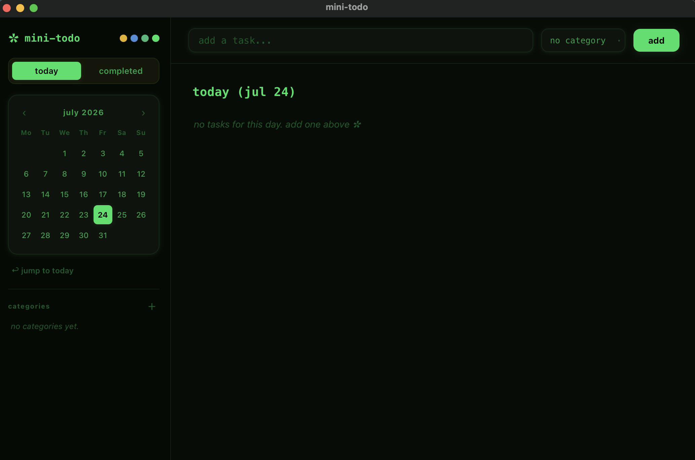
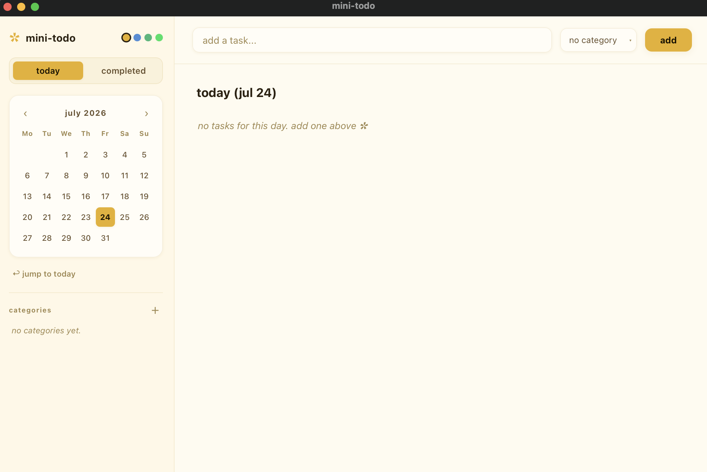

# ✿ cute todo-app

a minimal local to-do app with a warm butter yellow theme. calendar on the left to pick a day, to-do/completed tab switch, category tagging, and a clean task bar.

everything is stored in a single `tasks.json` file in your iCloud Drive (`iCloud Drive/Applications/mini-todo/tasks.json`; to put it somewhere else, change `ICLOUD_SUBDIR` in `app.py`), so it syncs between your macs. no account or internet service besides your own iCloud. (older versions kept it in `~/Library/Application Support/mini-todo/` — it's copied over automatically on first launch.)

## about xcode

you don't need xcode for this. the only thing you might need is the **xcode command line tools**, a small free download that provides compiler tools some python packages need on macos:

```bash
xcode-select --install
```

one-time ~1 gb install — not the full xcode app (~15 gb).

## setup (one time)

```bash
# 1. go into the project folder
cd todo-app

# 2. create a virtual environment
python3 -m venv venv
source venv/bin/activate

# 3. install dependencies
venv/bin/python -m pip install -r requirements.txt
```

if `pywebview` fails with a compiler error, run `xcode-select --install` and try again.

## run it

```bash
source venv/bin/activate   # if not already active
python3 app.py
```

a window titled "mini-todo" opens. close the window to quit — your tasks stay in `tasks.json`.

## use it on your iphone (no mac needed)

the phone version runs inside **scriptable**, a free iphone app, and edits the same `tasks.json` in icloud drive — so it works anywhere (5g, offline) even when your mac is off. icloud syncs the changes both ways.

one-time setup:

1. open the mac app once, so it creates `iCloud Drive/Applications/mini-todo/` (with your tasks and a `ui/` folder).
2. install [scriptable](https://apps.apple.com/app/scriptable/id1405459188) on your iphone and open it once.
3. open the mac app again — it copies `phone/mini-todo.js` into scriptable's icloud folder, and the script shows up in scriptable on your phone. (or copy `phone/mini-todo.js` there yourself via the files app.)
4. in scriptable: **settings → file bookmarks → +** → pick the `iCloud Drive/Applications/mini-todo` folder and name it exactly `mini-todo`.
5. tap the **mini-todo** script to run it. to get a home-screen icon, use the shortcuts app: new shortcut → "run script" → mini-todo → add to home screen.

every time the mac app starts it refreshes the ui files in icloud, so ui changes reach the phone automatically. don't edit `mini-todo.js` inside scriptable — it gets overwritten.

if the phone and the mac both edit while one of them is offline, whichever syncs last wins (icloud may keep the other as `tasks 2.json`).

## use it on your phone over wi-fi

while the app is open on your mac, it also serves itself on your home wi-fi. click **📱 open on phone** in the sidebar to copy the link (it looks like `http://192.168.x.x:8765/?key=...`), send it to your phone, and open it in safari. tip: share → **add to home screen** to get an app icon.

- your phone must be on the same wi-fi, and the mac app must be running.
- the `key` in the link keeps other people on the network out — don't share it. delete `web_key.txt` next to `tasks.json` to make a new one.
- the first time, macos may ask whether python can accept incoming connections — click **allow**.

## using the app

- **calendar (left)** — click any day to select it. use `‹` `›` to browse months, "jump to today" to snap back. a small dot under a date means it has tasks.
- **add a task** — type in the bar at the top, optionally pick a category from the dropdown, then press **add** or hit **enter**.
- **to-do tab** — shows open tasks for the selected day. click the circle to mark done; click the text to edit; `✕` on hover to delete.
- **completed tab** — shows finished tasks with the time they were completed.
- **categories (left panel, below calendar)** — click `＋` to create a new category. categories appear as colored badges on tasks and as a list in the sidebar. click a category to see all its tasks across every day (grouped by date; click a date to jump to it). click it again to go back. hover a category to delete it.

## app demo 





## notes

- data is a single local json file — fine for personal use.
- syncs via iCloud Drive between macs; the phone works through the mac over wi-fi — built for single-user use.
- all visual styles live in `ui/style.css` — colors and spacing are easy to tweak.
